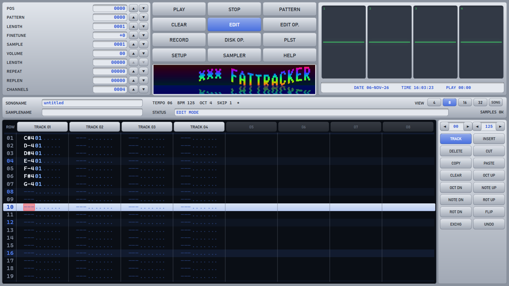
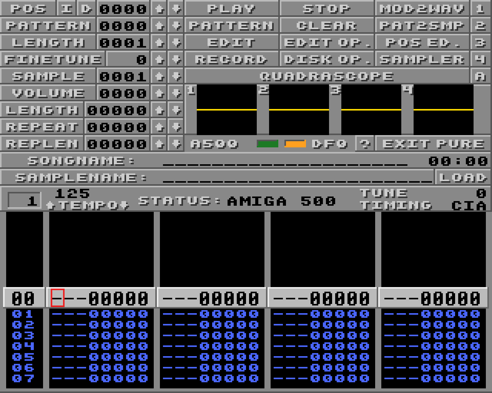

# FatTracker

A ProTracker-style music tracker for Windows (C++20, Win32, Direct2D, WASAPI). It has two faces:

- **Modern mode** – a vector UI in the ProTracker 2.3 layout that scales smoothly to any window
  size, with up to 32 channels, 16-bit samples, XM instruments and selectable themes.
- **Pure mode** – a pixel-exact ProTracker-style Amiga lowres screen (320×256) stretched over the
  window, with the A500 or A1200 Paula output filters (and the "LED" filter) and floppy drive sounds.
  Both modes share the same song and editing state; switch in SETUP or with EXIT PURE.

FatTracker builds to a single, statically linked `FatTracker.exe` – no installer.





## Features

**Editor**
- Pattern editing with ProTracker keys, edit skip, octave, block select / cut / copy / paste,
  track and pattern cut / copy / paste, insert / delete rows, undo / redo.
- Pattern view of 4, 8, 16 or 32 channels; mute (click a track header) and solo (right click).
- **EDIT OP.** – transpose (track, pattern, block or whole song; optionally one sample only),
  exchange / swap sample numbers, new / cloned patterns, pattern length, record options.
- **POS ED.** (Pure mode) – position list editor.
- **RECORD** in two modes, **STEP** (one row per note) and **LIVE** (notes land on the playing row,
  with quantize and an optional metronome); right click the RECORD button to switch.
- **SAMPLER** – sample editor: cut / copy / paste / crop / mix, silence, volume ramp, reverse,
  normalize, 8 ↔ 16 bit, low-pass / high-pass, echo, boost, pencil drawing, resample (half /
  double), "tune to C" (pitch detection), loop editing, and recording from the default audio input.
  Pure mode adds PAT2SMP (render the pattern into a sample).
- **XM instrument editor** (Ctrl+I) – volume / panning envelopes, key map, fadeout, auto-vibrato.
- **DISK OP.** – file browser with module and sample filters, load, save, rename, export.
- Per-channel scopes and VU meters; the chip players show per-voice VU meters and scopes too.
- Playback options: interpolation (none / linear / cubic), stereo separation, master volume.
- Themes: HYBRYDA, CLASSIC PT 2.3, PT 3.61 BLUE, NEO-AMIGA and a CUSTOM palette editor.
  Settings are kept in `FatTracker.ini` next to the exe.

## Supported formats

**Modules – loaded into the editor**

| Format | Extensions |
|---|---|
| ProTracker MOD (31 samples, 1–32 channels) and Soundtracker (15 samples) | `.mod`, `mod.*`, `.stk` |
| FastTracker 2 XM | `.xm` |
| Scream Tracker 3 | `.s3m` |
| Impulse Tracker (incl. IT214 / IT215 compressed samples) | `.it` |
| MultiTracker | `.mtm` |
| Composer 669 | `.669` |
| OctaMED / MED Soundstudio (MMD0–MMD3) | `.med`, `.mmd0` … `.mmd3` |
| DigiBooster 1.x and DigiBooster Pro | `.digi`, `.dbm` |
| Symphonie | `.symmod` |

**Saving**
- XM (the native format), MOD export (FatTracker lists what MOD cannot keep before writing),
  WAV render of the whole song (MOD2WAV in Pure mode).
- Samples are saved as WAV.

**Samples – loading**
- WAV (8/16/24/32-bit PCM, 32-bit float, `smpl` loop), IFF 8SVX, AIFF / AIFF-C
  (8–32-bit PCM, `sowt`, `fl32`; INST sustain loop). Stereo is mixed to mono.

**Playback only (chip music and other replayers)**

| Platform / format | Extensions |
|---|---|
| TFMX (Chris Huelsbeck) | `mdat.*` + `smpl.*`, `.mdat`, `.tfx` |
| Future Composer 1.0–1.4, Jochen Hippel (TFMX, COSO, MCMD) | `.fc`, `.fc13`, `.fc14`, `.smod`, `.hip`, `.hipc`, `.hip7`, `.sog`, `.mcmd`, `.coso` |
| AHX / HivelyTracker | `.ahx`, `.thx`, `.hvl` |
| JamCracker | `.jam` |
| Delta Music 1.0 / 2.0 | `.dm`, `.dm1`, `.dm2` |
| SidMon 1.0 / 2.0 | `.sid1`, `.sid2`, `.sd1`, `.sd2`, `.smn` |
| SoundMon V.2 / V.3 | `.bp`, `.bp2`, `.bp3`, `.sndmon` |
| Digital Mugician 1 / 2 | `.dmu`, `.dmu2`, `.mug`, `.mug2` |
| David Whittaker | `.dw`, `.dwold` |
| IFF SMUS (instruments loaded from the song's folder) | `.smus` |
| Sonic Arranger | `.sa`, `.sonic` |
| Art Of Noise | `.aon`, `.aon4`, `.aon8` |
| C64 SID | `.sid`, `.psid`, `.rsid` |
| Atari ST SNDH, SC68, YMST (68000 emulation) | `.sndh`, `.sc68`, `.ymst` |
| AY-3-8910 / YM2149 register dumps | `.ym`, `.vtx`, `.psg` |
| ZX Spectrum Pro Tracker 3 / Vortex Tracker II | `.pt3` |
| ZX Spectrum Sound Tracker, ST Song Compiler, Pro Tracker 2, ASC Sound Master, SQ-Tracker | `.stc`, `.st11`, `.st13`, `.pt2`, `.asc`, `.sqt` |
| Game_Music_Emu: SNES SPC, Mega Drive / Master System VGM and GYM, Atari 8-bit SAP, ZX / CPC AY, NES NSF / NSFE, Game Boy GBS, PC Engine HES, MSX KSS | `.spc`, `.vgm`, `.vgz`, `.gym`, `.sap`, `.ay`, `.nsf`, `.nsfe`, `.gbs`, `.hes`, `.kss` |

Most Amiga formats also load with the Amiga prefix naming (`hip.name`, `jam.name`, …). Songs with
several sub-songs step through them with the POS counter.

## Building

Requirements: Visual Studio with the MSVC C++ workload and CMake 3.28 or newer.

```powershell
cmake -S . -B build
cmake --build build --config Release
```

Targets:
- `FatTracker` – the application, `build\Release\FatTracker.exe`
- `fttest` – the test runner and command-line tools, `build\Release\fttest.exe`
- `ftrender` – offline render of any song (modules and chip formats) to WAV, no audio device:
  `build\Release\ftrender.exe in.sid out.wav [--seconds S] [--subsong N] [--float]`

CMake collects the sources with globs; run the configure step again after adding files.

## Running the tests

```powershell
build\Release\fttest.exe                  # all tests
build\Release\fttest.exe mod_vibrato      # one test
build\Release\fttest.exe render in.mod out.wav [--interp none|linear|cubic] [--rate 48000]
build\Release\fttest.exe compare a.wav b.wav
```

Tests that need the (not distributed) `modules` folder or reference renders report SKIP.
Optional comparisons against OpenMPT renders: see `tests/ref/README.md`.

## Using FatTracker

Start `FatTracker.exe`, then drag a module or sample onto the window, press **Ctrl+O**, or use
DISK OP. The HELP panel lists all keys; the basics:

| Key / mouse | Action |
|---|---|
| F5 / Right Alt | Play song |
| Right Ctrl | Play pattern |
| Space | Stop / edit mode on-off |
| Arrows, Tab / Shift+Tab | Move cursor, next / previous track |
| Ctrl+Left / Right | Song position |
| F1 / F2 | Octave down / up |
| F11 | View 4 / 8 / 16 / 32 channels |
| Z S X D C V G B H N J M / Q 2 W 3 E R 5 T 6 Y 7 U | Notes, lower / upper octave (edit mode) |
| 1 | Key off |
| Del / Shift+Del | Clear field / cell |
| Ins / Backspace | Insert / delete row (Shift: all tracks) |
| Shift+arrows, Ctrl+C / X / V | Select block, copy / cut / paste |
| Ctrl+Z / Ctrl+Y | Undo / redo |
| Ctrl+O / Ctrl+S | Open module / save XM |
| Ctrl+I | XM instrument editor |
| Click / right click track header | Mute / solo |
| Alt+Enter | Full screen |
| Esc | Close panel |

Developer screenshot mode (renders one frame offscreen to a PNG):
`FatTracker.exe --shot out.png [width height [module [seconds [view [keys]]]]]`.

## Source layout

- `src/core` – song model, player (PT 2.3 / FT2 behaviour), mixer, Paula filters, sample tools,
  chip and Amiga replayers and the third-party emulators
- `src/formats` – module loaders and writers, sample files (WAV, 8SVX, AIFF)
- `src/audio` – WASAPI output and capture, the engine
- `src/ui` – Direct2D renderer, fonts, themes, the modern and Pure screens and their panels
- `src/app` – window, input, file loading and saving
- `tests` – the `fttest` runner

## Licence

FatTracker – Copyright (C) 2026 fatman73. Free software under the **GNU General Public License,
version 2 or (at your option) any later version**; see [LICENSE](LICENSE). It includes or is based on
third-party components under their own licences (GPL, LGPL, MIT, BSD); they are listed in
[CREDITS.txt](CREDITS.txt), with the licence texts next to the code.

Repository: https://github.com/fatman73/FatTracker
